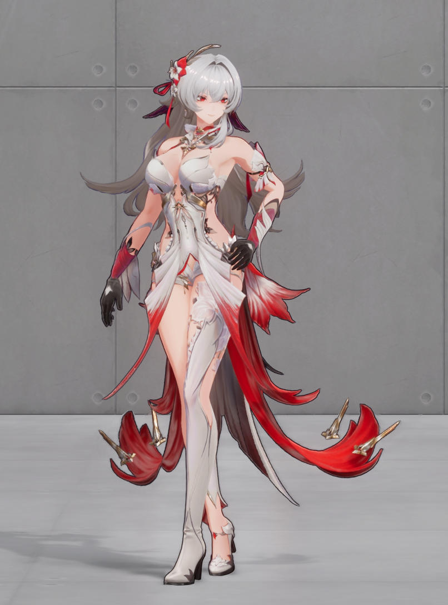
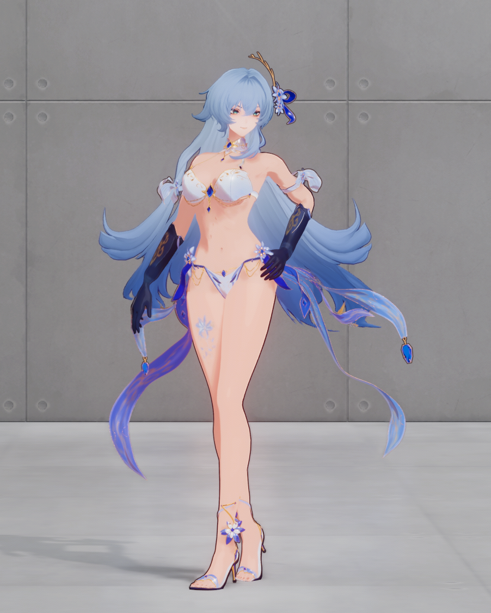
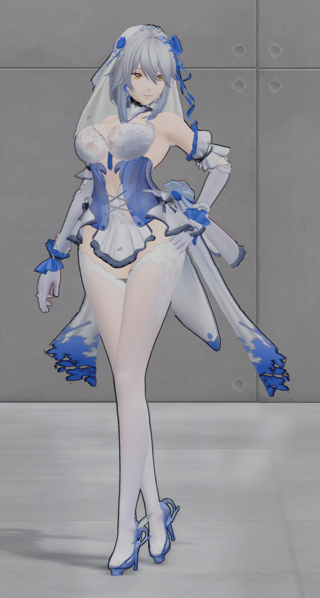
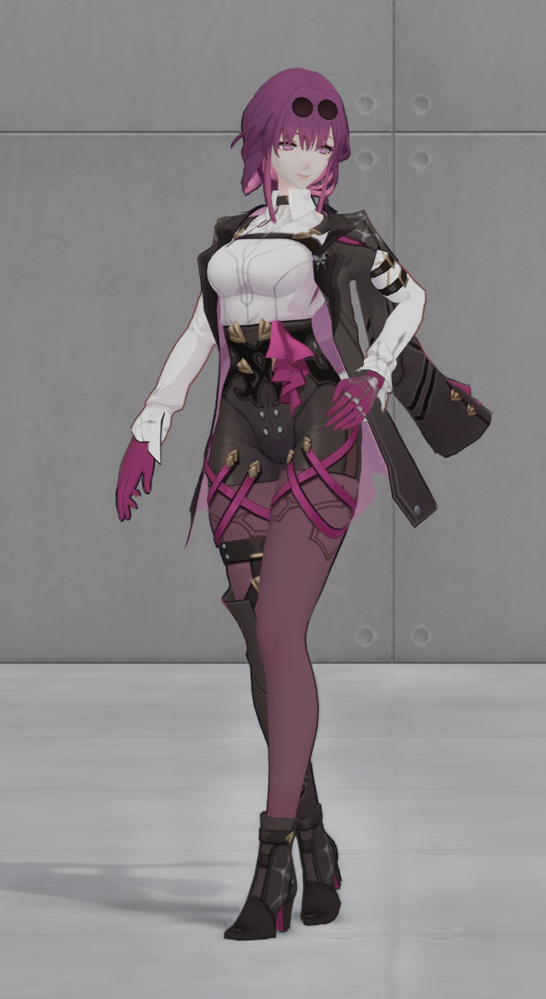
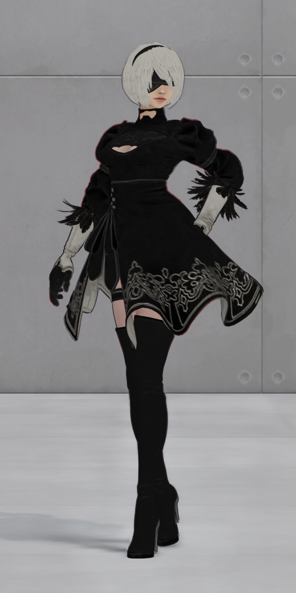
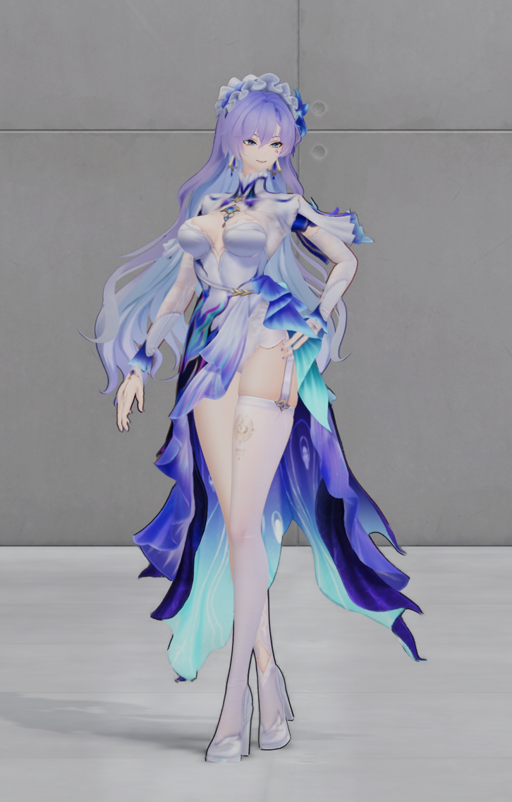

# 绿梦 Mod · 非商业技术探索与实践

这是一个由玩家个人发起的非商业 Mod 制作与技术探索项目。

## 项目初衷

本项目源于个人对《绿梦》的兴趣，以及对游戏 Mod 制作技术的探索。

在尝试制作 Mod 的过程中，我进行了一些模型替换、渲染适配、着色器调整与特效替换方面的研究，并取得了一些阶段性成果。

我个人的技术积累和工作成果其实十分有限，也谈不上做出了多么了不起的东西。

建立这个项目，只是希望将自己在制作过程中积累的一些经验、工具、技术资料和实践记录整理出来，为今后有兴趣研究 Mod 制作的玩家提供一点参考。

如果这些内容能够帮助后来者少走一些弯路，我就认为这件事有意义。

## 项目内容

目前主要涉及以下方向：

- 模型替换与模型适配
- 游戏渲染流程研究
- 着色器替换与调整
- 特效资源的适配与替换
- Mod 制作工具与相关技术研究
- 制作过程中的问题记录与解决方案

项目内容将根据实际进展逐步整理和更新。

## 非商业声明

本项目完全出于个人兴趣与技术研究目的，不以盈利为目标。

- 不出售 Mod、工具或相关技术资料。
- 不通过本项目进行商业化运营。
- 不以本项目谋取任何形式的经济利益。
- 公开内容仅用于技术交流、学习和研究。

## 版权与知识产权声明

本项目并非游戏官方项目，与游戏开发商、发行商及其官方团队不存在任何隶属、授权或合作关系。

游戏名称、角色、模型、贴图、音频、商标及其他原有知识产权均归其相应权利人所有。

本项目仅希望分享个人制作过程中产生的原创代码、工具、技术记录及其他经确认可以公开的内容。

不会以本项目为名义传播未经授权的游戏本体或原始游戏资源。

## 关于官方态度

我尊重游戏开发者及相关权利人的知识产权与作品管理权。

如果游戏官方或相关权利人明确表示不允许本项目继续公开，或者提出停止传播、下架或删除相关内容的要求，我会立即停止项目的公开与分发，并删除相关内容。

不会以个人研究、非商业用途或其他理由拒绝执行官方明确提出的合理要求。

## 最后

我只是一个喜欢这款游戏、对 Mod 制作感兴趣的普通玩家。

这个项目没有什么宏大的目标，也不打算成为一个商业化的 Mod 团队。

只是希望把自己尝试过的东西留下来，让后来对这方面感兴趣的人能够有所参考。

如果您也对 Mod 制作感兴趣，希望这些微小的尝试能够对您有所帮助。

感谢所有尊重原创、支持 Mod 创作以及愿意分享技术经验的人。

<!-- reviewed-v0.1.0 -->
## 可用工具与当前实例 · 0.1.5-BETA-V2（紧急优化帧数）

[下载管理器与六套 Mod](https://github.com/Arist-1122/lvmeng-mod/releases/download/0.1.5-BETA-V2/lvmeng-mod-manager-0.1.5-BETA-V2.zip) · [发布说明](https://github.com/Arist-1122/lvmeng-mod/releases/tag/0.1.5-BETA-V2) · [源码包](https://github.com/Arist-1122/lvmeng-mod/releases/download/0.1.5-BETA-V2/lvmeng-mod-source-0.1.5-BETA-V2.zip) · [SHA-256 校验文件](https://github.com/Arist-1122/lvmeng-mod/releases/download/0.1.5-BETA-V2/lvmeng-mod-manager-0.1.5-BETA-V2.zip.sha256)

修复了 D3D12 描述符跟踪开销。本机实测约 30 FPS 恢复到 100–110 FPS。

这一版在同一个管理器窗口中提供莉特莉丝「绮夜寐影」的六套外观。游戏运行期间可以换装、切回原模型，再继续换装。

1. 完整解压运行包，打开 `LvmengModManager.exe`，选择已安装的 `Lumin.exe` 并检查兼容性。
2. 选中初始外观，点「用所选皮肤启动」。手动启动时，先等助手就绪，再从自己的游戏启动器进入。
3. 进入莉特莉丝「绮夜寐影」后，在同一管理器窗口选择外观并点「应用所选皮肤」。点「切回原模型」可恢复原版外观。

| 红黑与技能受光 | 星潮晶华 | 里芙 |
| --- | --- | --- |
|  |  |  |

| 卡芙卡 | 2B | 坎特蕾拉 |
| --- | --- | --- |
|  |  |  |

六套都是阶段性成果。红黑仍有部分特效使用原版颜色。星潮晶华是原创泳装，版型、轮廓和材质还需打磨。其余四套已接通角色模型与表情绑定，部分场景仍会发灰。游戏更新后请重新检查兼容性。

[六套外观详情、技术流程与验证范围](docs/releases/v0.1.5-beta/README.md) · [历史版本 v0.1.2-D](https://github.com/Arist-1122/lvmeng-mod/releases/tag/v0.1.2-D) · [全部版本](https://github.com/Arist-1122/lvmeng-mod/releases)
