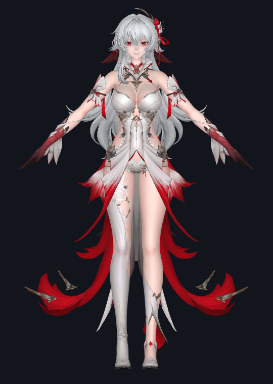
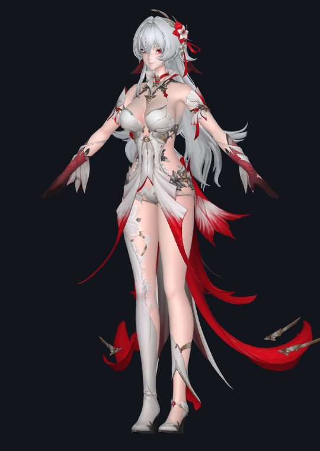
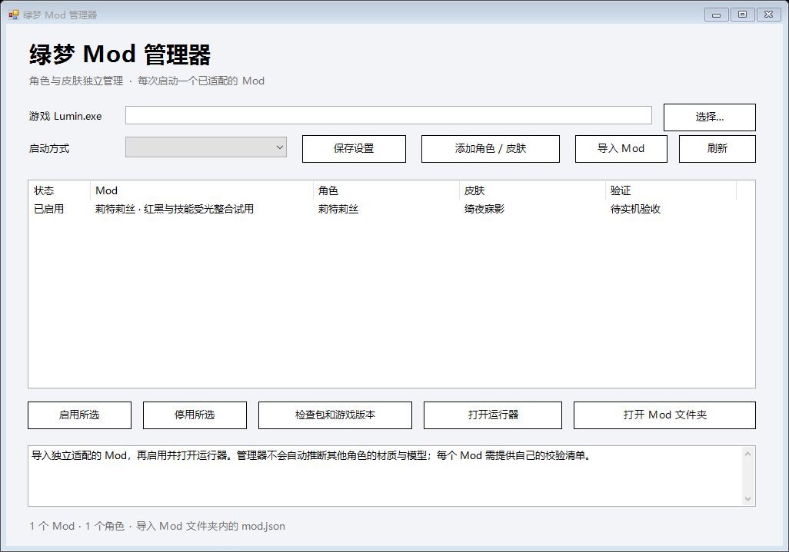

# 绿梦 Mod · 非商业技术探索与实践

这是一个由玩家个人发起的非商业 Mod 制作与技术探索项目。

## 项目初衷

本项目源于个人对《绿梦》的兴趣，以及对游戏 Mod 制作技术的探索。

在尝试制作 Mod 的过程中，我进行了一些模型替换、渲染适配、着色器调整与特效替换方面的研究，并取得了一些阶段性成果。

我个人的技术积累和工作成果其实十分有限，也谈不上做出了多么了不起的东西。

建立这个项目，只是希望将自己在制作过程中积累的一些经验、工具、技术资料和实践记录整理出来，为今后有兴趣研究 Mod 制作的玩家提供一点参考。

如果这些内容能够帮助后来者少走一些弯路，我就认为这件事有意义。

## 项目内容

目前主要涉及以下方向：

- 模型替换与模型适配
- 游戏渲染流程研究
- 着色器替换与调整
- 特效资源的适配与替换
- Mod 制作工具与相关技术研究
- 制作过程中的问题记录与解决方案

项目内容将根据实际进展逐步整理和更新。

## 非商业声明

本项目完全出于个人兴趣与技术研究目的，不以盈利为目标。

- 不出售 Mod、工具或相关技术资料。
- 不通过本项目进行商业化运营。
- 不以本项目谋取任何形式的经济利益。
- 公开内容仅用于技术交流、学习和研究。

## 版权与知识产权声明

本项目并非游戏官方项目，与游戏开发商、发行商及其官方团队不存在任何隶属、授权或合作关系。

游戏名称、角色、模型、贴图、音频、商标及其他原有知识产权均归其相应权利人所有。

本项目仅希望分享个人制作过程中产生的原创代码、工具、技术记录及其他经确认可以公开的内容。

不会以本项目为名义传播未经授权的游戏本体或原始游戏资源。

## 关于官方态度

我尊重游戏开发者及相关权利人的知识产权与作品管理权。

如果游戏官方或相关权利人明确表示不允许本项目继续公开，或者提出停止传播、下架或删除相关内容的要求，我会立即停止项目的公开与分发，并删除相关内容。

不会以个人研究、非商业用途或其他理由拒绝执行官方明确提出的合理要求。

## 最后

我只是一个喜欢这款游戏、对 Mod 制作感兴趣的普通玩家。

这个项目没有什么宏大的目标，也不打算成为一个商业化的 Mod 团队。

只是希望把自己尝试过的东西留下来，让后来对这方面感兴趣的人能够有所参考。

如果您也对 Mod 制作感兴趣，希望这些微小的尝试能够对您有所帮助。

感谢所有尊重原创、支持 Mod 创作以及愿意分享技术经验的人。

<!-- reviewed-v0.1.0 -->
## 可用工具与当前实例 · v0.1.1 预览版

[下载完整管理器与莉特莉丝 Mod](https://github.com/Arist-1122/lvmeng-mod/releases/download/v0.1.1-preview/lvmeng-mod-manager-v0.1.1-preview.zip) · [快速开始](docs/快速开始.md) · [更新兼容策略](docs/更新兼容策略.md) · [完整技术流程](docs/技术流程.md) · [验证与限制](docs/验证与限制.md)

完整包解压后打开 `LvmengModManager.exe`，选择自己的 `Lumin.exe`，检查包与游戏版本，再打开内置 Mod 的运行器。如果下载整个源码仓库，可双击根目录“启动管理器.cmd”，离线校验和组装后打开相同管理器。管理器支持添加角色、皮肤和独立适配的 Mod，游戏及管理器目录可更换。

当前实例保留原几何、动画和 UV，提供银发红瞳、红白黑服装、黑红无人机及红黑战斗特效。新增目标表面受光和命中/破防星芒补充已合入。共享特效受单人前台与目标衣装见证约束；共享资源并不构成独占角色归属，具体边界见验证文档。

v0.1.1 修复官网启动器客户端被固定 EXE/DLL 哈希拒绝的问题。已知客户端与更新客户端均验证游戏身份、64位架构、Unity 分支、完整渲染来源和最新完整缓存清单；程序文件变化且这些条件仍匹配时可以继续使用。渲染资源变化或无法验证时会说明原因，运行时精确资源守卫保留。本机位置、用户设置和诊断留在本地，发布 ZIP 不包含这些信息。

当前完整组合通过离线检查与独立包链审查，仍待用户实机验收。不能把离线结果理解为所有动作已经实机通过，也不承诺未知客户端更新后继续适用。

| 银发红白黑原服装：正面 | 斜侧 |
| --- | --- |
|  |  |

以上是 2026-11-04 设计阶段的离线模型展示，早于本次特效与受光补充。

源码和构建入口见 [source/README.md](source/README.md)。第三方组件保留各自许可证；项目许可证不改变游戏资源和第三方代码的权利归属。发布包没有完整 stock 图集、游戏 Bundle/CAB、模型库、本机游戏位置或会话日志。

完整文件摘要见 [release_manifest.json](release_manifest.json) 与 [SHA256SUMS.txt](SHA256SUMS.txt)。
