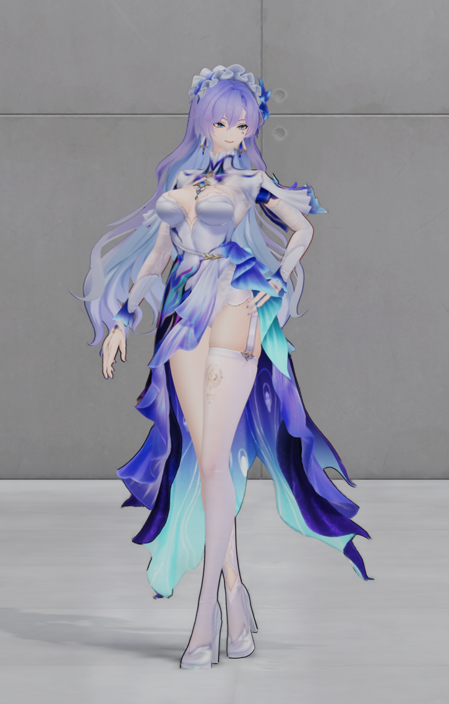
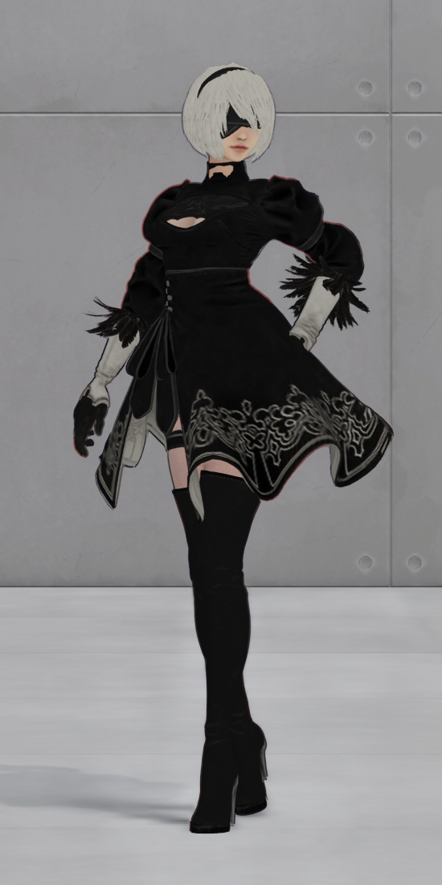
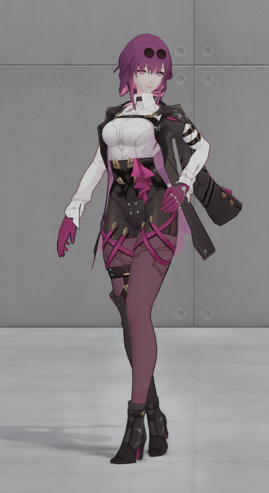
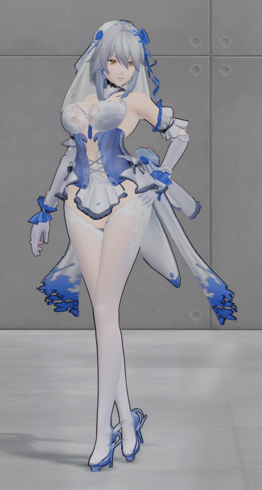
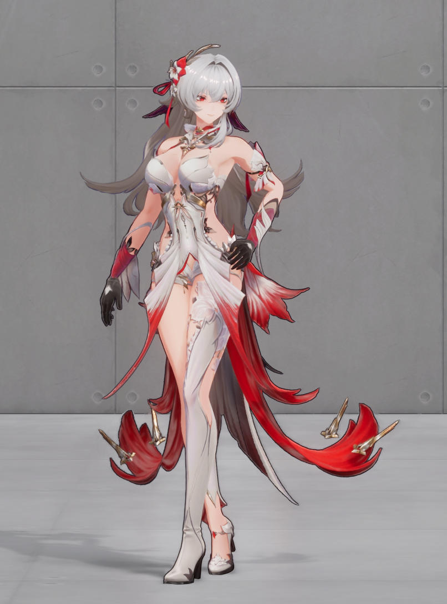
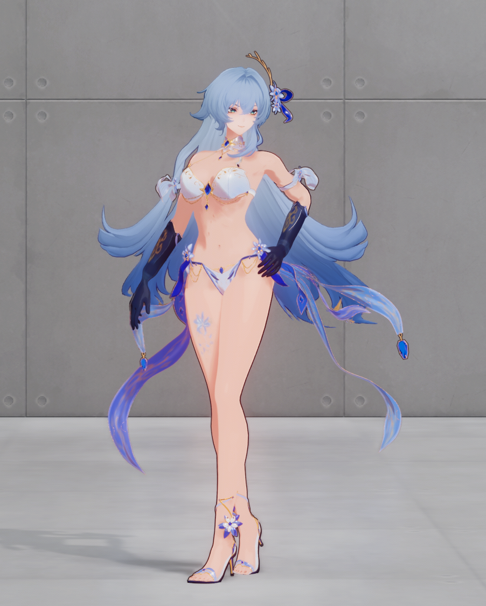

不盈利！
完全开源！
纯兴趣项目！
官方介意立刻隐藏/删帖！
只是希望能够帮到大家！

# 《绿梦：时空之声》Mod 管理器 v0.1.5-beta

这一阶段整理了莉特莉丝「绮夜寐影」的六款 Mod。里芙、卡芙卡、2B 和坎特蕾拉接入莉特莉丝的身体动作和表情，另有红黑和原创泳装「星潮晶华」。本地 Beta 已把六款外观接入同一个管理器，可以在同一次游戏会话中换装，也可以切回游戏的原模型后继续换装。

这六款都是阶段成果。以下图片为本次提供的外观展示，具体画面会随游戏场景和光照变化。四套跨游戏成品包含供体网格与贴图，公开分发有待取得相应许可。

## 六款 Mod

### 莉特莉丝 · 坎特蕾拉

来自《鸣潮》的坎特蕾拉外观。保留供体服装和饰件，适配莉特莉丝的身体、眼部与表情动作。接入 21 个供体形变，并根据原版动作重建瞳孔放大及独立高光移动。已在离线回放中覆盖所核对大招的 16 个启用表情通道。

### 莉特莉丝 · 伊芙 · 2B 联动服装

来自《剑星》的伊芙 2B 联动服装。保留黑色眼罩和原来的衣装轮廓，依据莉特莉丝的原版口部运动重建 11 个口部形变。调整脸、白发和黑衣暗部受光，让黑布、手套和羽毛更容易看清；保留白袖亮部和原有透明裁剪。

### 莉特莉丝 · 卡芙卡

来自《崩坏：星穹铁道》的卡芙卡外观。保留原外套与淡紫色内衬，修正外层重复反面与描边覆盖。校准虹膜跟随，接入 22 个供体形变，覆盖离线所核对大招的 14 个启用通道，另外两个通道仍待适配。

### 莉特莉丝 · 里芙 · 爱意凝晶

来自《尘白禁区》的里芙婚纱外观。校准虹膜骨骼权重并接入 18 个供体形变，原版动作可驱动闭眼、张嘴与眉眼变化。此版模型与表情已在原单卡运行流程中通过展示、连续闪避和大招的实机验收。

### 莉特莉丝 · 红黑与技能受光

沿用莉特莉丝原版模型、骨骼与动画，提供银发、红瞳、红黑服装和无人机改色，并适配部分红色战斗特效、受光、命中和破防星芒。换装会话内的红色特效按当前外观与受支持的战斗场景启用。仍有一些技能与战斗特效会显示原版颜色。

### 莉特莉丝 · 星潮晶华

泳装造型与服装建模为纯原创，沿用莉特莉丝原脸和原版战斗特效。后发描边错位已在此前实机复测中修正。泳装目前的建模效果不甚理想，版型、轮廓和材质还需要继续打磨。

## 这一版做了什么

- **统一启动与会话换装。** 管理器在同一个窗口提供六张中文卡，选好初始外观即可启动。目标外观的资源准备完成后，在呈现帧边界切换。选择「切回原模型」会恢复原版绘制，并保留当前会话供下一次换装。首次运行会准备本地工作目录，进程状态检查使用所需的有限权限。
- **重新绑定四套角色外观。** 使用原莉特莉丝的动作、骨骼调色板与运行时表情权重，按身体、头发、脸和眼睛处理绘制，修正网格绕序和描边。表情映射以供体已有形变为优先，只有缺少对应形变且能从原版几何或动作核对时才重建。
- **近景清晰度与动作覆盖。** 四套替换从供体贴图重烘 992×992 的高清贴图页，保留紧凑贴图路径。适配展示、普通动作、大招及连续闪避中已识别的颜色、深度、阴影、遮眼与描边路径。2B 本次受光调整另做了 76 组离线多渲染目标对照。
- **减少多套并存的 CPU 开销。** 稳定展示或战斗时，会话运行时只向当前外观转发高频图形绑定事件。准备切换时最多涉及当前和目标两套，原模型稳态跳过这些转发。效果已在同一 D3D12 软件测试环境中比较，实际游戏帧率仍需在相同战斗场景下复测。

## 可公开的技术

可公开的技术包括管理器与启动流程、D3D12 图形事件分派、网格拆分与骨骼权重适配、贴图页生成、表情映射、着色器适配、会话切换与状态恢复。

运行时先核对原版顶点和像素着色器、顶点布局、目标纹理及其资源代际、绘制范围与深度模板状态。身份条件匹配时才接管相应绘制，提交后恢复原有图形绑定。替换资源和运行合同使用 SHA-256 核对。软件渲染回放还对照透明覆盖、运动、辅助输出与法线，并测试包内文件被改动时的拒绝路径。离线验证覆盖的条件可供其他 Mod 作者复用。

项目自己编写的代码按仓库许可证公开源码，现行许可证为 PolyForm Noncommercial 1.0.0。ReShade 等第三方组件保留各自许可证。游戏名称、角色、模型、贴图、音频和商标等权利归各自权利人。[项目源码仓库](https://github.com/Arist-1122/lvmeng-mod) · [项目许可证](https://github.com/Arist-1122/lvmeng-mod/blob/main/LICENSE)

## 已有适配运行包时的操作

1. 完整解压适配的 Windows 运行包，打开 `LvmengModManager.exe`。
2. 在管理器中选择自己已安装的 `Lumin.exe`，完成客户端和包完整性检查。
3. 选初始外观，点「用所选皮肤启动」。选择手动启动时，先等助手就绪，再从自己的启动器进入。
4. 进入莉特莉丝「绮夜寐影」后，回同一管理器窗口选外观并点「应用所选皮肤」。点「切回原模型」即可恢复原版外观，之后仍可以继续换装。

## Beta 的验证范围与限制

- 里芙、卡芙卡、2B 和坎特蕾拉已打通角色模型与表情绑定，作为替换外观可以试用。实际材质、渲染和打光还没做好，部分场景看起来发灰。里芙的 R10 单卡模型和表情已有实机验收，不同设备、镜头和战斗场景的覆盖仍有限。
- 大招及闪避只覆盖已识别的本体绘制，独立残影、活动演出或其他尚未识别的绘制可能继续呈现原版。供体未提供对应形变的通道仍可能存在表情差异。
- 红黑仍有部分特效尚未替换，共享战斗特效受目标衣装与场景条件约束。星潮晶华和四套跨游戏外观沿用原版战斗特效。多人场景、共享特效表现与不同硬件上的帧率仍待验证。
- 客户端更新后仍要通过图形资源和包完整性检查，未知版本的兼容性以检查和实际复测为准。公开包排除本机设置、安装路径、账号或 UID、登录与鉴权数据和会话诊断。

不盈利！
完全开源！
纯兴趣项目！
官方介意立刻隐藏/删帖！
只是希望能够帮到大家！
