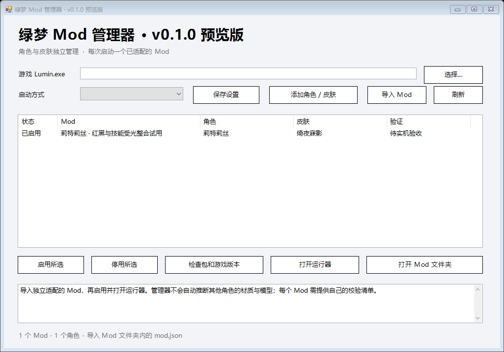

# v0.1.2 预览版：快速开始

这是一套可移动的 Windows Mod 管理器，内置莉特莉丝「绮夜寐影」红白黑外观、银发和红黑特效适配。**最新整包尚待实机视觉验收，不能据此宣称全特效已经全部更换完毕。**

1. 下载并完整解压发布页中的 `lvmeng-mod-manager-v0.1.2-preview.zip`，保留其全部子目录。
2. 打开 `LvmengModManager.exe`，选择游戏安装目录的 `Lumin.exe`，保存设置。普通打开或「以管理员身份运行」都可以；不用为了使用工具修改 UAC。默认通过 TapTap 启动，也可选择直接或手动启动。
3. 内置 Mod 首次打开已启用。选中它，点击「打开运行器」，再在运行器中点击启动。助手需要权限时，由用户处理 Windows 的权限确认；取消后按运行器提示重试。
4. 选择自动启动时，工具优先从当前桌面的普通用户上下文启动游戏或启动器。选择「手动启动游戏」时，先等待运行器提示助手已经就绪、正在等待游戏，再从自己的官网或 TapTap 启动器正常进入。已经以高权限打开管理器时也按相同步骤操作。
5. 进入莉特莉丝「绮夜寐影」，检查外观、普攻、技能、必杀、命中/破防、下落和闪避。运行器提交计数只用于诊断，不能单独证明所有效果已命中。
6. 若停止后续换色，已上传的衣装和头部颜色须正常退出游戏后恢复。工具不会强行结束游戏。

如果 UAC 已关闭、整个桌面都以高权限运行，或者没有可用的普通桌面上下文，启动权限由实际系统环境决定。工具不会要求调整这些设置，也不能在所有环境下保证创建普通权限进程。提示与处理方法见[启动权限与排障](启动权限与排障.md)。

## 导入与角色/皮肤

「导入 Mod」选择已解压 Mod 中的 `mod.json`。导入会校验该包并登记其角色和皮肤；新导入项默认停用，用户启用后再打开运行器。同一角色与皮肤只启用一个 Mod，用户主动停用的选择会保留。也可以先用「添加角色 / 皮肤」登记名称，ID 必须与 Mod 清单一致。

每个角色/皮肤仍需要自己的实际适配包。添加一个名称不会自动生成模型、材质或特效识别规则。当前每次启动一个 Mod 运行器。

## 既有图形适配与离线证据

- 21份角色表面技能受光程序，与既有战斗程序保留分离；源蓝光只在精确目标表面身份成立时转换，Unity灯对象、地板和其他角色受光不随该路径统一改色。
- 两份命中/破防补充程序保留原VS/PS及前台单人共享范围；完整Groups元数据随源码证据归档。共享资源没有角色独占性，同一共享窗口内相同资源的其他对象也可能一起改色。
- 完整原版stock纹理流不随Mod分发；通过真实上传的完整mip SHA确认原纹理身份。独立core/WARP夹具确认72 mip和6个owner。
- 既有版本已做管理器、整包迁移、资源身份与负例检查；各项结果的范围见[验证与限制](验证与限制.md)。v0.1.2 的启动权限修复不把这些离线结果升级为游戏实机验收。

上述离线结论不替代逐招实机验收。原生分派API垫片、真实core上传夹具与完整游戏场景是不同的证据层。最终运行包的固定文件、版本与摘要以发布清单为准。

## 开发与来源

项目自有管理器、托管入口、Bootstrap和native分派源码在 [source](../source/README.md)。自改ReShade核心的精确上游commit、完整patch、11个子模块pins、22份依赖许可证及构建方法见 [core-patch](../source/core-patch/README.md)。发布校验清单见仓库根 `release_manifest.json` 和 `SHA256SUMS.txt`。

本机路径、控制会话和日志不在发布ZIP里。管理器会在用户选择位置后生成本机设置；校验失败时请核对客户端适配版本，不要自行跳过版本守卫。

沿用 v0.1.1 的客户端程序更新兼容规则，见[更新兼容策略](更新兼容策略.md)。
