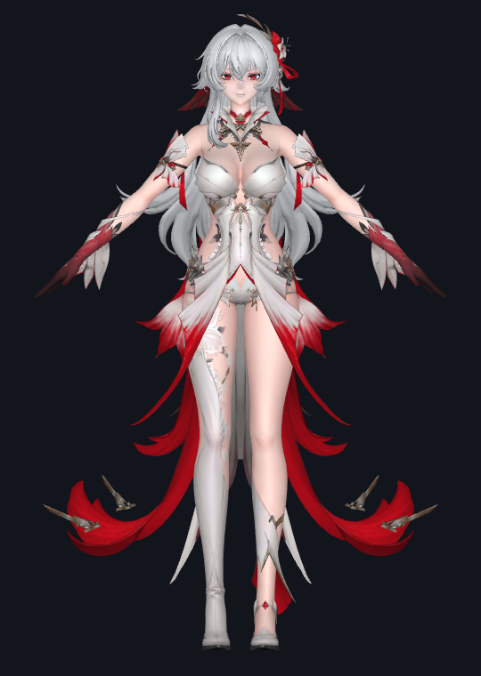
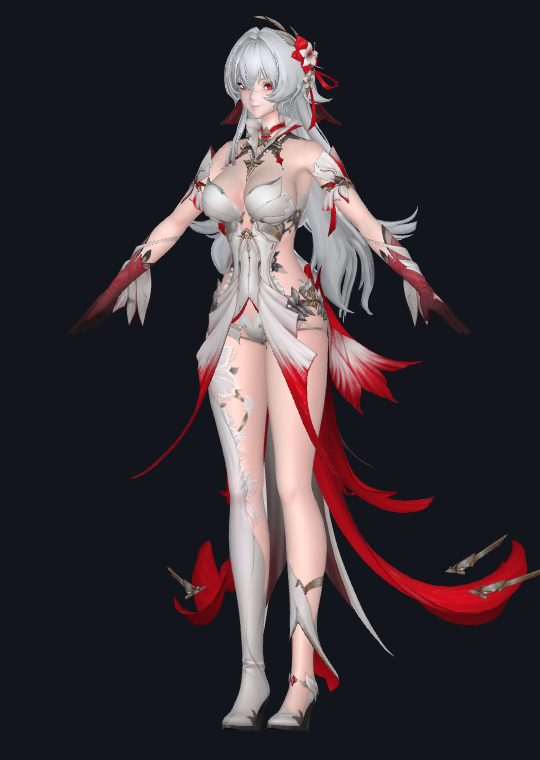
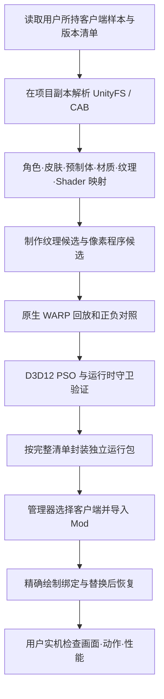
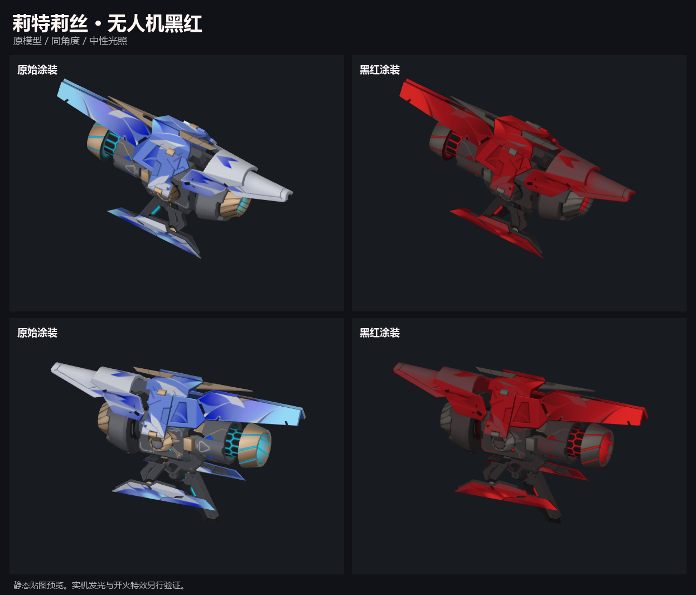
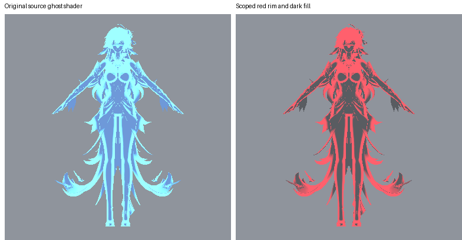
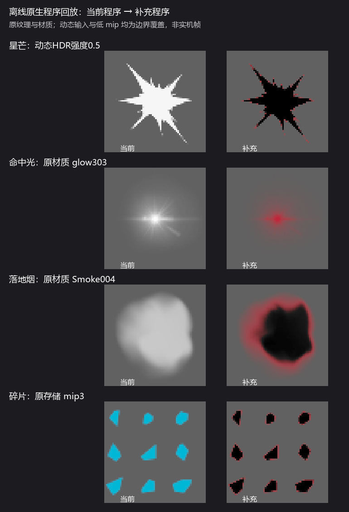
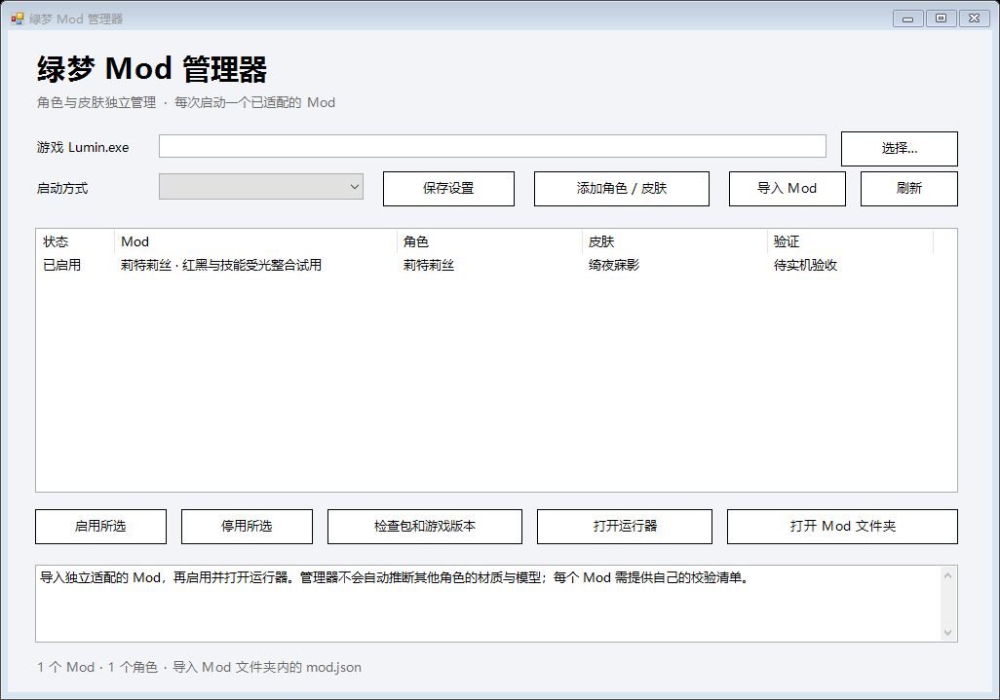

# 绿梦 Mod：技术流程

本项目为《绿梦：时空之声》Windows 客户端制作角色外观与特效的独立适配工具。当前实例是莉特莉丝 `role_26` 的绮夜寐影 `role_26_02`：银发、红瞳、红白黑服装及红黑特效。当前分支保留原模型几何、UV 和原动画流程，主要在确切纹理上传及原生像素程序上实施修改。

本文记录截至 **2026-11-06** 的实际工程路线。便携管理器、托管与原生运行入口、Bootstrap、无完整 stock 原图的纹理匹配，以及命中和 Light 补充，已经合入同一运行包。当前包含 77 个固定清单文件，整包迁移与自检通过；最新组合尚未完成实机验收，验证范围见[验证与限制](验证与限制.md)。下面六张图均为离线展示或工具界面预览，版本写在各图说明中。

| 正面 | 斜侧 |
| --- | --- |
|  |  |

*2026-11-04 红白黑服装设计阶段的离线模型预览，早于后续材质、特效和 Light 修正；不代表最新包的实机画面。使用原服装完整造型，没有使用早期推定参考体。*

## 从资源到运行包



### 1. 读取与提取

已研究的客户端样本采用 Unity 2022.3.62f2、IL2CPP 与原生 Direct3D12。适配首先记录客户端版本样本和摘要，再从项目副本读取清单、UnityFS 归档、序列化对象及外部纹理数据。安装目录和已有游戏会话在离线研究中保持只读。

提取结果包括网格、材质、纹理、预制体引用和平台原生 Shader 程序。原始纹理尺寸、压缩格式、mip 层级及字节摘要一并记录，供后续确认来源。Unity 资源能被离线解析，只能证明读取这一层；客户端是否加载候选包需要单独验证。

### 2. 建立角色与特效映射

从角色和皮肤对象沿引用关系追踪预制体、渲染器、材质、纹理与 Shader。资源名用于检索，归属由 CAB、PathID、引用图、原生程序和纹理身份共同确认。

同一招动作可能同时使用光束、星芒、烟圈、碎片、残影、武器发光和 Unity Light。一个预制体或一个像素程序改色成功后，仍需检查同链条的其他层。共用资源另外保留条件，避免把通用命中、其他角色或场景一起染色。

### 3. 制作外观与特效候选

外观路径制作与原图对应的 BC7 候选，保留源尺寸、透明度和完整 mip 链。当前适配包括两张头发图集、脸部图集、两张身体图集和武器图集。

发布包只携带六份改色后的图集流，不携带六份完整原版 stock 纹理。运行时先用每 mip 的八个稀疏块排除错误输入，再对真正上传的紧密行内容计算完整 SHA-256；行间 padding 被排除。只有完整 mip 摘要匹配后才换入候选。已在真实 core 的独立 WARP 宿主验证全部 72 个 mip 和六组纹理身份，稀疏指纹本身不授权替换。



*2026-11-05 终验阶段的无人机静态涂装对照。两侧使用原模型、同角度与中性光照；机身发光和开火表现另行验证。*

特效路径从 Unity 的 PC 程序目录恢复确切 DXBC，记录原 VS/PS 的长度和摘要。在保留原透明度、混合方式、材质流程、辅助目标布局及无关输出的前提下，编译、嵌入并签名候选像素程序。程序内部继续核对原材质常量、纹理尺寸和样点等条件。

PSO 是一条绘制所用的管线状态组合。本项目的候选克隆保留原 PSO 的非像素程序部分，仅替换已核对的 PS；原 VS、根签名、几何输入及混合状态继续参与验证。



*2026-11-05 收尾阶段：使用原人形网格和原残影程序进行 WARP 回放，右侧为暗色填充与红色轮廓候选，保留渐隐。不是实机截图。*

### 4. 分别处理 Light 受光

粒子像素改色不会修改 Unity Light。新增 Light 路径从源灯光颜色与 Shader 反射定位 `_MainLightColor`、`_AdditionalLightsColor` 的读取位置，对三组确切蓝色源光分别处理 gamma / linear 输入，并保留强度和其他光色。

这条路径按目标完整纹理身份选择头发、Body01、Body02、脸、眼及武器的专用候选。它改变这些目标表面的受光计算，保留已有手掌校色和武器动态发光。Unity Light 对象本身、地板及其他角色的受光没有随这条路径一起修改。

### 5. 离线验证与运行时绑定

候选先通过 Microsoft 软件 WARP 执行原生程序回放，再核对原生 VS/PS 与候选的 D3D12 PSO。测试包含目标材质，以及错误材质、错误纹理、其他颜色、失效状态等负对照。普通字段回放、原生管线创建和真实客户端绘制分别记录，结论按证据层级发布。



*2026-11-05 收尾阶段的原生程序回放。动态 HDR 与低 mip 是守卫覆盖测试，不表示已定位视频中每一笔漏色的真实调用。*

运行时组件还要核对会话、所有者、宿主、有效期、原 VS/PS、根签名、描述符及资源代数。需要完整纹理归属的路径，只有确认目标 mip0 后才可替换。描述符和根参数在绘制前重复核对；未能证明的绘制交回原有路径。候选绘制结束后恢复原管线。

共享特效沿用单人前台条件与目标衣装见证。状态里的克隆、提交次数用于诊断调用范围；它们不直接表示某个材质分支或最终像素已命中。

## 便携管理器与 Mod 格式

当前管理器基于 Windows x64 与 .NET Framework 4.x，负责选择用户自己的 `Lumin.exe`、选择启动方式、导入和启停独立 Mod，以及检查清单与兼容版本。托管入口、原生组件、Bootstrap 和配置模板已完成路径迁移，合同与固定文件摘要已重新计算。完整包通过中文、空格目录迁移等 26 项检查；源码也已在移动目录内独立重编通过。上述检查没有启动游戏或调用加载器。



*2026-11-06 整合管理器的离屏界面预览。内置莉特莉丝 Mod 默认启用，游戏位置留给用户选择，验证栏明确显示“待实机验收”。没有启动游戏。*

使用仓库 Releases 提供的完整管理器压缩包，全部解压并保留 `mods` 目录。打开 `LvmengModManager.exe`，选择游戏本体 `Lumin.exe` 后保存设置，再对内置项点击“打开运行器”。运行器默认通过 TapTap 正常启动游戏；选择莉特莉丝“绮夜寐影”后，在单人场景核对外观、技能、必杀及闪避。源码压缩包用于阅读和构建，不替代完整管理器运行包；最终下载文件和摘要以 `delivery/manifest.json` 为准。

目录约定：

```text
LvmengModManager.exe
mods/
  litelisi-redblack/
    mod.json
    runtime/
      LvmengModelTool.exe
      package.json
      payload/
      addons/
user-data/
```

`mod.json` 示例：

```json
{
  "version": 1,
  "id": "litelisi-redblack",
  "name": "莉特莉丝 · 红黑",
  "characterId": "role_26",
  "skinId": "role_26_02",
  "runtimeDirectory": "runtime",
  "entryPoint": "LvmengModelTool.exe",
  "packageManifest": "package.json"
}
```

`characterName`、`skinName` 可提供显示名称；实际适配归属以 ID 和运行包合同为准。发布包按相对路径组织文件与客户端版本样本，游戏位置由本机配置保存。用户配置、安装位置、会话和日志不提交仓库，也不纳入不可变包文件摘要。

当前管理方式每次打开一个 Mod 运行器，同一角色和皮肤只允许一个启用项。内置莉特莉丝适配默认启用，新导入的其他 Mod 默认停用。支持 TapTap、直接启动和手动启动三种方式。停止运行器会停止后续替换；已经上传的外观纹理通过正常退出游戏并重启恢复。

## 扩展到新角色

1. 为新角色建立独立 ID、皮肤 ID、来源清单和兼容版本样本。
2. 提取它的网格、纹理、材质和完整动作特效引用图，并明确哪些资源与他人共用。
3. 为目标图集、VS/PS、根绑定和必要几何状态建立新的身份合同；保留其他角色、原皮与相邻资源作为负对照。
4. 制作候选并完成原生回放、PSO、上传归属、停止/失效及资源寿命验证。
5. 封装独立运行包与 `mod.json`，通过管理器导入后验证画面、动作和性能，再发布该适配。

管理器可以容纳新的清单；材质、网格和特效规则需要逐角色适配。复制莉特莉丝的 ID 或规则，不能建立其他角色的兼容性。

## 仓库内容与来源

仓库收集工具原创源码、构建规则、差分描述、脱敏验证摘要和精选预览。客户端安装文件、原始 Bundle/CAB、完整原始模型与纹理库、反编译缓存和个人会话不作为源码仓库内容上传。构建所需的原始样本由使用者在本机提供。

工具源码、第三方组件、游戏资源与预览分别保留来源和适用说明。本项目的源码许可不自动覆盖第三方组件、游戏资产或由游戏资产生成的预览；各组件应保留自身的许可与版权说明。

`source/evidence` 中部分元数据保留研究机器的历史项目路径，供来源、Groups 和回执摘要复核。它们不参与运行定位；新版运行器依赖自身目录、包内相对路径及用户选择的游戏位置。证据文件与交付清单分别承担来源记录和最终文件校验职责。
